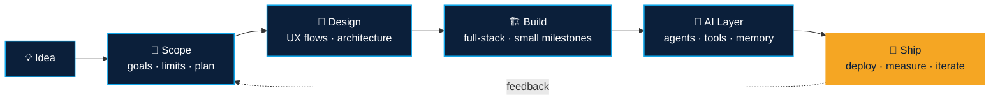

<!--
  Before publishing:
  1. Add your email / LinkedIn / portfolio in the "Let's Build Something" section at the bottom.
  2. Check the "R&D Lab" table and keep only what you want public.
  3. Delete this comment.
-->

<div align="center">


[](https://github.com/build-with-fun)

<a href="https://github.com/build-with-fun">
  
</a>


</div>

<br/>

## 👋 Hi, I'm Ammar

I design and ship software end to end, from the first whiteboard sketch to a deployed production system. I work across the **MERN stack**, **Next.js 16**, **React Native**, and **agentic AI systems**, and I care just as much about the part many engineers skip: turning a vague idea into a clear scope and a clean architecture *before* the first line of code.

```ts
const ammar = {
  role:      "Full-Stack & Agentic AI Engineer",
  builds:    ["web platforms", "mobile apps", "AI agents that do real work"],
  coreStack: ["Next.js 16", "Node.js", "MongoDB", "LangGraph"],
  approach:  "scope → design → build → ship → iterate",
  habit:     "sketches the architecture on paper before opening the editor",
  openTo:    ["freelance projects", "collaborations", "ambitious ideas"],
} as const;
```

<br/>

## 🛠️ What I Build

| 🧩 Full-Stack Products | 🤖 Agentic AI Systems | 📱 Mobile Apps |
|:---|:---|:---|
| End-to-end web platforms: UX, API, database and deployment, built to grow with the product. | Multi-agent workflows with planning, sub-agents, tools and memory, designed to be reliable, not just impressive in a demo. | Cross-platform apps with React Native and Expo, sharing logic with the web where it makes sense. |
| `Next.js` `React` `Node.js` `Express` `MongoDB` `PostgreSQL` | `LangGraph` `LangChain` `CrewAI` `OpenAI Agents SDK` `Deep Agents` | `React Native` `Expo` `TypeScript` |

<br/>

## 🧭 How a Project Flows

Every project starts as a plan, not a prompt:



<br/>

## 🤝 Working With Me

| | |
|:---|:---|
| 📝 **Scope before code** | A written plan up front: what we're building, what we're not, and how we'll know it works. |
| 🔍 **No black boxes** | Architecture decisions explained in plain language, not buried in the code. |
| 🎯 **Small, demo-able steps** | Progress lands in milestones you can click through, not in one big reveal at the end. |
| 📦 **Clean handoff** | Readable code, clear documentation, and a project you can run without me. |

<br/>

## 🔬 R&D Lab

Ambitious things I'm building on the side, because the best way to learn a stack is to build it from scratch.

| Project | What it is | Stage |
|:---|:---|:---|
| **Xeno** | A from-scratch Python agent framework | Architecture |
| **Nyx** | An AI-native browser designed from the ground up | Engineering spec |
| **Voice-to-voice model** | A speech-in, speech-out model written from scratch in Python and NumPy | Research & planning |
| **AI glasses** | Custom PCBs with mic, speaker and flash, linked to a PC over the internet and to a phone over Bluetooth | Hardware R&D |

<br/>

## 🧰 Tech Stack

| | |
|:---|:---|
| **🤖 Agentic AI** |       |
| **Frontend** |       |
| **Backend** |    |
| **Mobile** |   |
| **Databases** |    |
| **Languages** |    |
| **Tools** |        |

<br/>

## 📬 Let's Build Something

Got an idea that's still rough around the edges? That's usually the best time to talk. Bring the idea, and we'll turn it into a plan.

<div align="center">

<a href="https://wa.me/923140313359"> 
   
</a>


<!-- Uncomment and fill in:
<a href="mailto:YOUR-EMAIL">
  
</a>
<a href="https://www.linkedin.com/in/YOUR-HANDLE">
  
</a>
<a href="https://YOUR-PORTFOLIO.com">
  
</a>
-->


</div>
