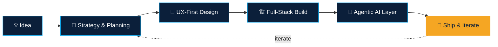

<!--
  SETUP (delete this block when done):
  1. Create a PUBLIC repo named EXACTLY "build-with-fun" (it must match your GitHub username).
  2. Upload this file as README.md at the root of that repo.
  3. Uncomment the LinkedIn / Portfolio / Email badges below and fill in your links.
-->

<!-- Uncomment and fill in:
 

-->

---

## 🧑‍💻 About Me

I design and ship full-stack products end to end, from the first whiteboard sketch to a deployed production system. Day to day that means the **MERN stack** and **Next.js 16**, and more and more **agentic AI systems** built with LangChain, LangGraph, CrewAI, the OpenAI Agents SDK, and Deep Agents. I also build mobile apps, and I put real time into the part a lot of engineers skip: turning a vague idea into a scoped plan and a clean architecture *before* the first line of code.

| | |
|---|---|
| 🏗️ **Building** | Production-grade agentic workflows with LangGraph and the OpenAI Agents SDK |
| 🧠 **Exploring** | Hierarchical multi-agent patterns with Deep Agents and CrewAI Flows |
| 🎯 **Strength** | Ambiguous idea → scoped plan → clean architecture → shipped product |
| 💬 **Ask me about** | Next.js 16, agent harnesses (planning, sub-agents, memory), MERN system design |
| ⚡ **Fun fact** | I sketch the architecture on paper before I open the editor |

 

## 🧭 How I Work

Every project starts as a plan, not a prompt:

 

## 🧰 Tech Stack

| | |
|---|---|
| **Languages** |    |
| **Frontend** |       |
| **Backend** |   |
| **Mobile** |   |
| **Databases** |    |
| **🤖 Agentic AI** |       |
| **Tools** |        |

 

<!--
## 🚀 Featured Projects
Pin your best repos on your profile, or list them here:

| Project | What it does | Stack |
|---|---|---|
| [**Project name**](https://github.com/build-with-fun/REPO) | One-line description | Next.js · MongoDB · LangGraph |
-->

## 📊 GitHub Stats

  
  

---

**Got something ambitious in mind, like an agentic AI product or a full-stack platform? Let's build it.** 🚀

